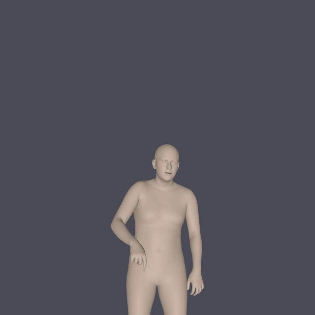

# Text2Sign

> An experimental project for generating sign language animation from Vietnamese text. Existing components include dictionary-based tokenization, pose estimation with SMPLer-X, conversion of SMPL-X data to AMASS, retargeting to X-Bot FBX, and a web-based animation viewer.

## Preview

[](assets/demo/sign-animation.mp4)

Click the preview image to open the short sample render. The full video datasets, model weights, and generated outputs remain external project assets and are not included in this repository.

> **Status:** This repository contains several experimental branches and local data. It is not yet a turnkey application: model weights, input videos, SMPL-X data, Blender, and other runtime components must be prepared separately. This guide describes the code and configuration currently present in the project tree.

## Components

| Directory | Purpose |
|---|---|
| `Text2Sign/` | Vietnamese tokenizer, dictionary generation, and experimental pose extraction and Blender visualization scripts. |
| `Smpler_X/` | Docker Compose configuration and a batch runner for SMPLer-X inference on `input_part_*` video folders. Requires model weights and an NVIDIA GPU. |
| `Text2Sign-duy_test_rokoko2/` | Pipeline for converting SMPL-X output to AMASS `.npz` and X-Bot `.fbx`, with a FastAPI backend, FBX viewer frontend, and retargeting scripts. |

The intended processing flow is:

```text
Vietnamese text
  → tokenizer / gloss dictionary
  → sign clip or SMPL-X pose
  → AMASS .npz
  → retarget to X-Bot .fbx with Blender
  → display animation in the Three.js frontend
```

These steps are implemented in separate scripts and experimental branches. There is currently no single command that runs the entire pipeline end to end.

## Project structure

```text
.
├── README.md
├── .gitignore
├── Smpler_X/
│   ├── docker-compose.yml        # Uses a prebuilt SMPLer-X image
│   ├── docker-compose-org.yml    # References a Dockerfile not present here
│   ├── docker-GUIDE.md
│   └── run_all_parts.py
├── Text2Sign/
│   ├── VnTokenizer.py
│   ├── create_custom_dic.py
│   └── workspace/                # Experimental MediaPipe / Blender scripts
└── Text2Sign-duy_test_rokoko2/
    ├── convert_all_to_amass.py
    ├── retarget_from_amass.py
    └── fbxviewer/
        ├── index.html, main.js, style.css
        └── fbx_only_backend/     # FastAPI, queue, AMASS, and Blender pipeline
```

## Requirements

- Git, Python 3, Docker Engine, and Docker Compose v2.
- An NVIDIA GPU, NVIDIA drivers, and NVIDIA Container Toolkit to run SMPLer-X inference with GPU acceleration.
- Blender compatible with the retargeting pipeline. The `blender` command must be on `PATH`, or set `BLENDER_BIN` to its location.
- SMPLer-X weights, detector weights, an SMPL-X model, videos, and 3D assets. These resources are large and/or subject to licensing terms and are not bundled in this guide.
- Redis and PostgreSQL for the web backend. Install the Python packages listed in `fbx_only_backend/requirements_api.txt`.

## Prepare data and models

Do not commit videos, checkpoints, generated `.npz` or `.fbx` files, archives, or restricted models to Git. Obtain these resources from authorized sources and place them where the code expects them:

- SMPLer-X weights: `Smpler_X/pretrained_models/`, including detector files under `mmdet/`.
- Input videos grouped into batches: `Smpler_X/input_part_1/`, `input_part_2/`, and so on.
- Inference output: `Smpler_X/output_smplerx/`.
- SMPLer-X clips for conversion: `Text2Sign-duy_test_rokoko2/output_smplerx/<clip>/smplx/`.
- Neutral SMPL-X model: `Text2Sign-duy_test_rokoko2/models/smplx/SMPLX_NEUTRAL.npz`, or another location passed with `--smplx-model-path`.
- X-Bot FBX: by default, the script looks for `Text2Sign-duy_test_rokoko2/fbxviewer/fbx_only_backend/XBOTXBOT.fbx`; use `--xbot` to specify another path.
- Dictionary: `dictionary_data.csv` is not included in Git. Obtain an authorized copy and place it in the current working directory when running `VnTokenizer.py`. The local working tree has copies under `Text2Sign-duy_test_rokoko2/fbxviewer/fbx_only_backend/` and `Text2Sign/tokenizer/`, but these are ignored.

Directories containing `.gitkeep` files remain visible after cloning, but data files in those directories are ignored by `.gitignore`.

## Run the tokenizer

`VnTokenizer.py` requires `pandas` and `underthesea`. Run it from a directory containing `dictionary_data.csv`:

```bash
python -m pip install pandas underthesea
cd Text2Sign-duy_test_rokoko2/fbxviewer/fbx_only_backend
python ../../../Text2Sign/VnTokenizer.py
```

The tokenizer prioritizes dictionary phrase matches, then tokenizes unmatched text with Underthesea. With `filter_unknown=True`, tokens not found in the dictionary are discarded. `create_custom_dic.py` generates a filtered CSV and a JSON alias map; it also expects `dictionary_data.csv` in the current working directory.

## Run SMPLer-X inference

See [`Smpler_X/docker-GUIDE.md`](Smpler_X/docker-GUIDE.md) for more details. The current Compose file uses the `aduy2408/smpler_x:latest` image and mounts weights, videos, and output from the host:

```bash
cd Smpler_X
VIDEOS_FOLDER="$PWD/input_part_1" OUTPUT_DIR="$PWD/output_smplerx/input_part_1" \
  PRETRAINED_MODEL=smpler_x_s32 \
  docker compose run --rm smplerx \
  --videos_folder /videos --demo_results_root /output --fps 30
```

`run_all_parts.py` runs Compose for each batch. Check `PARTS_TO_RUN` before running: it is currently hardcoded to `[25, 26]`; set it to `[]` to discover every `input_part_*` directory. Run the script from `Smpler_X/`, since it invokes Compose using the current working directory. Compose defaults to `smpler_x_s32`; make sure the image and weights you use are compatible. `docker-compose-org.yml` references a `Dockerfile` that is not currently present in this directory.

## Convert SMPL-X to AMASS and FBX

Conversion scripts are in `Text2Sign-duy_test_rokoko2/` and its backend:

```bash
cd Text2Sign-duy_test_rokoko2
python convert_all_to_amass.py --help
python retarget_from_amass.py --help
```

`convert_all_to_amass.py` requires `numpy`, `scipy`, `tqdm`, and the backend under `fbxviewer/fbx_only_backend/`. By default, it reads `output_smplerx/`, uses the neutral model under `models/` (falling back to the backend directory), and writes AMASS files to `fbxviewer/fbx_only_backend/amass_output/`. `retarget_from_amass.py` runs Blender in background mode. Use `--help` to select input/output paths, clips, FPS, and the Blender binary. These steps require the data and models described above.

## Run the FBX viewer and API

The frontend is under `Text2Sign-duy_test_rokoko2/fbxviewer/`. The FastAPI backend and detailed instructions are in `fbx_only_backend/` and [`fbxviewer/README.md`](Text2Sign-duy_test_rokoko2/fbxviewer/README.md).

Serve the static frontend separately:

```bash
cd Text2Sign-duy_test_rokoko2/fbxviewer
python -m http.server 3000
```

Open `http://localhost:3000`. The API backend requires PostgreSQL, Redis, Blender, and the corresponding environment variables. Install its Python dependencies with:

```bash
cd Text2Sign-duy_test_rokoko2/fbxviewer/fbx_only_backend
python -m pip install -r requirements_api.txt
```

The Compose file at `fbxviewer/docker-compose.yml` runs the backend, worker, PostgreSQL, Redis, and monitoring services. The static frontend and pseudo translation API must be started separately as described in the nested README. Compose currently uses a prebuilt backend image and development defaults for the database and Grafana. Do not use these defaults in a public or production deployment. Check the API URLs in `main.js` if the frontend and backend are not on the same machine.

## Before publishing to GitHub

1. **Review data and distribution rights.** The local project tree is about 29 GB, mostly videos, model weights, outputs, FBX/Blend files, and archives. `.gitignore` excludes large data formats and generated files, but review `git status` and the size of the planned commit. Share videos, dictionaries, and assets only when their licenses permit it.
2. **Keep local machine settings private.** Do not commit `.env` or `.env.*` files. Use `.env.example` as a template, replace values with placeholders, and remove any real passwords or tokens.
3. **Review runtime configuration.** `Text2Sign/workspace/run_pipeline.bat`, `extract_motion.py`, and `blender_import.py` contain hardcoded Windows paths. `Smpler_X/run_all_parts.py` is limited to parts 25 and 26. Update these if you intend to publish them as general run instructions.
4. **Add release information.** There is no root `LICENSE` file. Choose a license for the source code and separately verify the terms for SMPLer-X, models, datasets, X-Bot, the Blender add-on, and other assets before distributing them.

Before staging changes:

```bash
git status --short
git check-ignore -v Text2Sign-duy_test_rokoko2/fbxviewer/fbx_only_backend/.env
git add README.md .gitignore
git diff --cached --stat
```

These commands stage only the README and `.gitignore`. Review the file list before staging anything else.

## Notes

- `Text2Sign/workspace/extract_motion.py` uses a hardcoded Windows video path. It is an experimental script, not a general-purpose configurable CLI.
- This guide summarizes the code and configuration currently present; the pipeline has not been verified in an end-to-end run.
